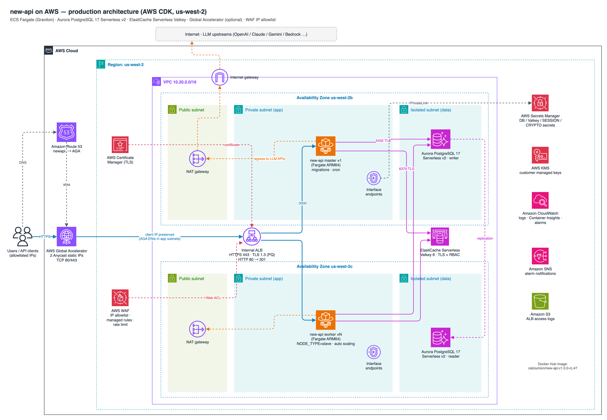

# new-api on AWS（CDK 生产级部署）

基于 AWS CDK (TypeScript) 部署 [QuantumNous/new-api](https://github.com/QuantumNous/new-api) 最新版本（默认镜像 `calciumion/new-api:v1.0.0-rc.47`，2026-10-25 发布，amd64/arm64 多架构）。
参考 `litellm-ecs-cloudformation` 的生产实践，区别：

| 项 | litellm 参考方案 | 本方案 |
|---|---|---|
| IaC | CloudFormation YAML + shell | AWS CDK v2 (TypeScript) + cdk-nag 合规检查 |
| 入口加速 | CloudFront + VPC Origin | **AWS Global Accelerator（可选，默认开启）** |
| ALB | Internal | 开启 AGA 时 **Internal**；关闭 AGA 时自动 internet-facing（可覆盖） |
| WAF | CloudFront 作用域（us-east-1） | REGIONAL，直接挂 ALB，**IP 白名单配置化** |
| 数据 | Aurora PG Serverless v2 + Redis Serverless | Aurora PG 17 Serverless v2 + ElastiCache Serverless **Valkey（RBAC 认证）** |

## 架构



> 可编辑源文件：[`architecture.drawio`](./architecture.drawio)（AWS 2025 图标集 `mxgraph.aws4`），由 `python3 scripts/gen-architecture.py architecture.drawio` 生成。

```
 Client ──TCP 80/443──▶ Global Accelerator (Anycast 静态 IP, 保留客户端 IP)        [enableAga=true]
                              │
 ┌──────────────── VPC (us-west-2, 2 AZ) ─────────────────────────────────────────────┐
 │ public  : NAT GW ×2（AGA 关闭时 ALB 放在这里，internet-facing）                     │
 │ app     : Internal ALB (TLS1.2/1.3 + WAF) ──▶ ECS Fargate (Graviton)               │
 │           │                                   ├─ master ×1   (迁移 / 定时任务)       │
 │           │                                   └─ worker ×N   (NODE_TYPE=slave, 自动扩缩) │
 │           └─ VPC Endpoints: SecretsManager / KMS / Logs / ECR / S3                  │
 │ data    : Aurora PostgreSQL 17 Serverless v2 (writer+reader)                        │
 │           ElastiCache Serverless Valkey 8 (TLS + RBAC)    —— 无出网路由             │
 └────────────────────────────────────────────────────────────────────────────────────┘
   出站：ECS ──NAT──▶ OpenAI / Claude / Gemini / Bedrock 等上游
```

全部为托管 / Serverless 组件：Fargate、Aurora Serverless v2、ElastiCache Serverless、ALB、AGA、WAF，无 EC2 需要运维。

### 栈划分

| 栈 | 内容 | 说明 |
|---|---|---|
| `newapi-network` | VPC、三层子网、NAT、安全组、VPC Endpoints、Flow Logs | 所有安全组集中在此，避免跨栈循环 |
| `newapi-data` | Aurora、Valkey、Secrets（DB / Valkey / SESSION_SECRET / CRYPTO_SECRET）、KMS | **终止保护**，DB 删除前自动快照 |
| `newapi-app` | ECS、ALB、WAF、AGA、ACM、Route 53、告警 | 开关 AGA / 改白名单 / 升级镜像只动这个栈 |

## 前置条件

- Node.js 20+、AWS CLI v2、有效凭证（`aws sts get-caller-identity` 可用）
- 首次在账号/区域执行 `./deploy.sh bootstrap`
- 生产环境需要一个域名：Route 53 托管区（自动签证书 + 建记录），或已有同区域 ACM 证书

## 快速开始

```bash
npm ci
./deploy.sh bootstrap

# 生产推荐：自定义域名 + HTTPS + 首次部署先开白名单
./deploy.sh deploy \
  -c domainName=api.example.com \
  -c hostedZoneId=Z0123456789ABC -c hostedZoneName=example.com \
  -c wafAllowedIpv4Cidrs=203.0.113.10/32 \
  -c alarmEmail=ops@example.com

# 不使用 AGA（ALB 自动变为 internet-facing）
./deploy.sh deploy -c enableAga=false -c domainName=api.example.com -c certificateArn=arn:aws:acm:us-west-2:...
```

参数优先级：`cdk.json` 默认值 < `config.local.json`（环境专属，已 gitignore，模板见 `config.local.example.json`，可用 `NEWAPI_CONFIG` 指定其他文件）< 命令行 `-c key=value`。域名、托管区 ID、白名单 IP 等放在 `config.local.json`，不要提交到仓库。首次部署约 20~30 分钟（Aurora 与 AGA 较慢）。

## 参数

| 参数 | 默认 | 说明 |
|---|---|---|
| `region` | `us-west-2` | 部署区域（也可用环境变量 `AWS_REGION` 给 deploy.sh） |
| `prefix` | `newapi` | 资源 / 栈名前缀，同账号多套环境用不同前缀 |
| `enableAga` | `true` | 是否启用 Global Accelerator |
| `albScheme` | `auto` | `auto`：AGA 开 → internal，AGA 关 → internet-facing；也可强制 `internal` / `internet-facing` |
| `domainName` | 空 | 自定义域名；与 `hostedZoneId`+`hostedZoneName` 或 `certificateArn` 组合启用 HTTPS |
| `hostedZoneId` / `hostedZoneName` | 空 | 提供则自动 DNS 验证签发 ACM 证书，并创建 A(Alias) → AGA / ALB |
| `certificateArn` | 空 | 已有 ACM 证书（必须在部署区域） |
| `wafAllowedIpv4Cidrs` | `[]` | IPv4 白名单（CIDR，单 IP 写 `/32`）。**非空即开启白名单模式** |
| `wafAllowedIpv6Cidrs` | `[]` | IPv6 白名单 |
| `wafRateLimitPer5Min` | `3000` | 单 IP 每 5 分钟请求上限，超出返回 429；`0` 关闭 |
| `image` | `calciumion/new-api:v1.0.0-rc.47` | 镜像，生产建议固定版本 |
| `imageRepositoryCredentialsSecretArn` | 空 | Docker Hub 凭证 Secret（避免匿名拉取限流），或改用 ECR 镜像 |
| `cpuArchitecture` | `ARM64` | `ARM64`(Graviton) / `X86_64` |
| `taskCpu` / `taskMemoryMiB` | `1024` / `2048` | 单任务规格 |
| `workerMinCount` / `workerMaxCount` | `1` / `10` | worker 副本范围（CPU 60% / 内存 75% 目标跟踪）；master 固定 1 |
| `streamingTimeoutSeconds` | `300` | new-api `STREAMING_TIMEOUT` |
| `timezone` | `Asia/Shanghai` | 容器 TZ |
| `readonlyRootFilesystem` | `true` | 只读根文件系统，`/data`、`/tmp` 为任务临时卷 |
| `enableExecuteCommand` | `false` | ECS Exec（排障时临时开启） |
| `extraEnvironment` | `{}` | 额外非敏感环境变量，如 `{"DEFAULT_LANGUAGE":"zh-CN"}` |
| `availabilityZones` | `[]` | 指定 AZ（某 AZ 的 NAT 等配额用满时使用），为空按 `maxAzs` 自动选 |
| `vpcCidr` / `maxAzs` / `natGateways` | `10.20.0.0/16` / `2` / `2` | 网络 |
| `enableInterfaceEndpoints` | `true` | Secrets Manager / KMS / Logs / ECR 接口终端节点 |
| `albDeletionProtection` | `true` | ALB 删除保护 |
| `albIdleTimeoutSeconds` | `600` | ALB 空闲超时 |
| `auroraEngineVersion` | `17.9` | Aurora PostgreSQL 版本 |
| `auroraMinAcu` / `auroraMaxAcu` | `0.5` / `8` | Serverless v2 容量 |
| `auroraBackupRetentionDays` | `14` | 自动备份保留天数 |
| `valkeyMajorVersion` | `8` | Valkey 主版本 |
| `valkeyMaxDataStorageGb` / `valkeyMaxEcpuPerSecond` | `5` / `15000` | 缓存用量上限（成本护栏） |
| `logRetentionDays` | `180` | 所有日志组保留期 |
| `alarmEmail` | 空 | 告警邮箱（需在邮件中确认订阅） |

## 部署后

1. 查看输出：`./deploy.sh outputs`（`ServiceUrl` / `AcceleratorDnsName` / `IpAllowlistMode` 等）。
2. 若未提供 hosted zone，按输出 `DnsTodo` 手工创建 CNAME（域名 → AGA DNS 名）。
3. 访问 `https://<domain>` 完成 new-api **初始化向导（创建 root 管理员）**。
   > ⚠️ 初始化完成前任何能访问到的人都可以抢先创建管理员，**首次部署务必配置 `wafAllowedIpv4Cidrs`**，初始化后再按需放开。
4. 在 new-api 后台添加渠道（OpenAI / Claude / Gemini / Bedrock 等）。上游若需要固定出口 IP 白名单，使用 NAT Gateway 的 EIP（VPC 控制台可查）。

## WAF IP 白名单

规则顺序（REGIONAL WebACL，挂在 ALB）：

| 优先级 | 规则 | 动作 |
|---|---|---|
| 0 | `IpAllowlist`（仅白名单非空时存在）：源 IP ∉ 白名单 | 403 |
| 1 | AWSManagedRulesAmazonIpReputationList | Block |
| 2 | AWSManagedRulesKnownBadInputsRuleSet | Block |
| 3 | AWSManagedRulesCommonRuleSet（`*_BODY` 类规则置 Count，避免 LLM 长请求体误杀） | Block |
| 4 | `RateLimitPerIp` | 429 |

- 白名单匹配的是**真实客户端源 IP**：AGA 开启了客户端 IP 保留（internal ALB 的硬性要求），不依赖可伪造的 `X-Forwarded-For`。
- 白名单内的 IP 仍会经过托管规则和限速。
- 修改白名单（约 1~3 分钟）：

```bash
# 改 cdk.json 的 wafAllowedIpv4Cidrs，或直接传参：
./deploy.sh deploy-app -c wafAllowedIpv4Cidrs=203.0.113.10/32,198.51.100.0/24
# 关闭白名单（全网可访问，只保留托管规则 + 限速）
./deploy.sh deploy-app -c wafAllowedIpv4Cidrs=
```

> 白名单以 CDK 配置为唯一来源。不要在控制台直接改 IP Set，下次 `cdk deploy` 会被覆盖。
> WAF 日志：CloudWatch Logs `aws-waf-logs-<prefix>`（已脱敏 `Authorization`、`Cookie`）。

## AGA 开关说明

- `enableAga=true`（默认）：AGA 两个 Anycast 静态 IP → TCP 透传 → internal ALB。TLS 在 ALB 终止，因此**生产必须配置域名 + 证书**，否则只有明文 HTTP:80（synth 时会告警）。
- `enableAga=false`：ALB 改为 internet-facing，DNS 直接指向 ALB。
- 切换 AGA 开关会改变 ALB scheme，CloudFormation 会**替换 ALB**（短暂中断，DNS 记录自动更新；手工 CNAME 需要改）。先把 `albDeletionProtection=false` 部署一次，再切换。
- AGA 的 TCP 空闲超时为 340 秒：流式响应只要持续有数据就不受影响；`STREAMING_TIMEOUT`（300s）小于该值。

## 安全与合规

| 领域 | 措施 |
|---|---|
| 网络 | 三层子网；ALB internal（AGA 唯一入口）；ECS 只接受 ALB SG；Aurora / Valkey 位于无出网的 isolated 子网，只接受 ECS SG；VPC Flow Logs（KMS 加密）；默认 SG 清空规则 |
| 入口 | WAF（白名单 / IP 信誉 / 恶意输入 / 通用规则 / 限速）；TLS 1.2/1.3（含后量子混合）；HTTP→HTTPS 301；ALB 丢弃非法头、desync 防御模式；ALB 访问日志 → S3 |
| 身份与密钥 | DB、Valkey、SESSION_SECRET、CRYPTO_SECRET 全部由 Secrets Manager 生成，以 ECS secrets 注入（不出现在模板/环境变量里）；Task Role 无任何 AWS 权限；执行角色仅能读取这 4 个密钥 |
| 加密 | 三个客户管理 KMS 密钥（自动轮换）：Aurora 存储 / PI、Valkey、Secrets、全部日志组、SNS；Aurora `rds.force_ssl=1` + `sslmode=require`；Valkey 强制 TLS + RBAC 密码 |
| 应用 | 只读根文件系统、init 进程、`TRUSTED_PROXIES` 仅信任 VPC 网段、HTTPS 时启用 `SESSION_COOKIE_SECURE` + `SESSION_COOKIE_TRUSTED_URL`；ECS Exec 默认关闭 |
| 数据保护 | Aurora 删除保护 + 删除前快照 + 14 天备份 + 跨 AZ reader；Valkey 每日快照 7 天；KMS / 日志 / CRYPTO_SECRET 删除栈时保留 |
| 可观测 | Container Insights（enhanced）、Aurora PI + 增强监控 + PostgreSQL 日志、告警（ALB 5xx、目标 5xx、不健康主机、CPU/内存、Aurora CPU/ACU）→ SNS |
| 合规检查 | 每次 synth 运行 cdk-nag `AwsSolutionsChecks`；所有豁免都在代码中写明理由（见 `lib/*.ts` 中 `acknowledge(...)`） |

账号级建议（不在本模板内）：开启 GuardDuty（含 ECS Runtime Monitoring）、Security Hub、CloudTrail 组织级 Trail、AWS Config。

## 运维

```bash
# 升级 new-api（滚动发布，断路器自动回滚）
./deploy.sh deploy-app -c image=calciumion/new-api:v1.0.0-rc.48

# 查看日志
aws logs tail /ecs/newapi/new-api --follow --region us-west-2

# 临时开启 ECS Exec 排障
./deploy.sh deploy-app -c enableExecuteCommand=true
aws ecs execute-command --cluster newapi-cluster --task <task-id> --container new-api --interactive --command /bin/sh
```

- master 与 worker 运行同一镜像：master（未设 `NODE_TYPE`）负责数据库迁移与定时任务，worker 为 `NODE_TYPE=slave`。首次部署 worker 在 master 稳定后才创建。
- 发布时 ALB 排空 300 秒 + 容器 `SHUTDOWN_TIMEOUT_SECONDS=110` / `stopTimeout=120`，在途流式请求有时间结束。
- 健康检查使用 `/api/status`（受 new-api 全局 API 限流，间隔设为 30s）。

## 删除

```bash
./deploy.sh destroy                         # 删除 app 栈
npx cdk destroy newapi-network -c region=us-west-2   # 等 AGA 释放 ENI 后再删
# 数据栈：确认数据已备份后
aws cloudformation update-termination-protection --no-enable-termination-protection --stack-name newapi-data --region us-west-2
aws rds modify-db-cluster --db-cluster-identifier newapi-aurora --no-deletion-protection --apply-immediately --region us-west-2
npx cdk destroy newapi-data -c region=us-west-2
```

app 栈开启了 ALB 删除保护，需要先 `-c albDeletionProtection=false` 部署一次。KMS 密钥、日志组、ALB 日志桶、CRYPTO_SECRET 为 RETAIN，需要手工清理。

## 已知限制 / 注意

- new-api 当前版本号为 `v1.0.0-rc.x`（官方 release 未标记 prerelease），上线前先在预发环境验证。
- Aurora 连接使用 `sslmode=require`（加密但不校验 CA，镜像未内置 RDS CA 包）；如需 `verify-full`，自建镜像加入 RDS CA 证书。
- new-api 使用非集群模式的 go-redis 客户端；ElastiCache Serverless 提供单一端点，常规单 key 命令 / Lua / 事务均可用，跨 slot 的多 key 命令不支持。
- 密钥未开启自动轮换（new-api 只在启动时读取连接串）；手工轮换后执行一次 `aws ecs update-service --force-new-deployment`。`CRYPTO_SECRET` 永远不要更改。
- 成本相关资源：NAT Gateway ×2、接口终端节点 ×5×AZ、AGA（固定费 + 流量）、ALB、WAF（WebACL + 规则 + 请求）、Fargate、Aurora ACU、Valkey ECPU/存储、KMS ×3。请使用 [AWS Pricing Calculator](https://calculator.aws/) 估算；测试环境可设 `natGateways=1`、`enableInterfaceEndpoints=false`。

## 目录

```
bin/new-ecs-cdk.ts     入口：组装 3 个栈 + cdk-nag
lib/config.ts          参数定义 / 校验（默认值在 cdk.json context）
lib/network-stack.ts   VPC / SG / Endpoints / Flow Logs
lib/data-stack.ts      Aurora / Valkey / Secrets / KMS
lib/app-stack.ts       ECS / ALB / AGA / DNS / 告警
lib/waf.ts             WAF WebACL + IP 白名单
lib/nag.ts             cdk-nag 豁免辅助
scripts/gen-architecture.py  生成 architecture.drawio
config.local.example.json    环境参数模板（复制为 config.local.json）
deploy.sh              一键脚本
```
